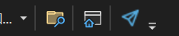
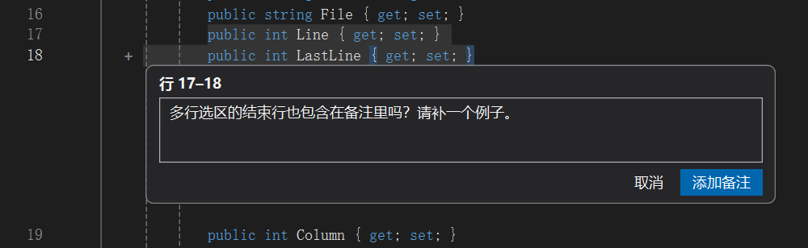
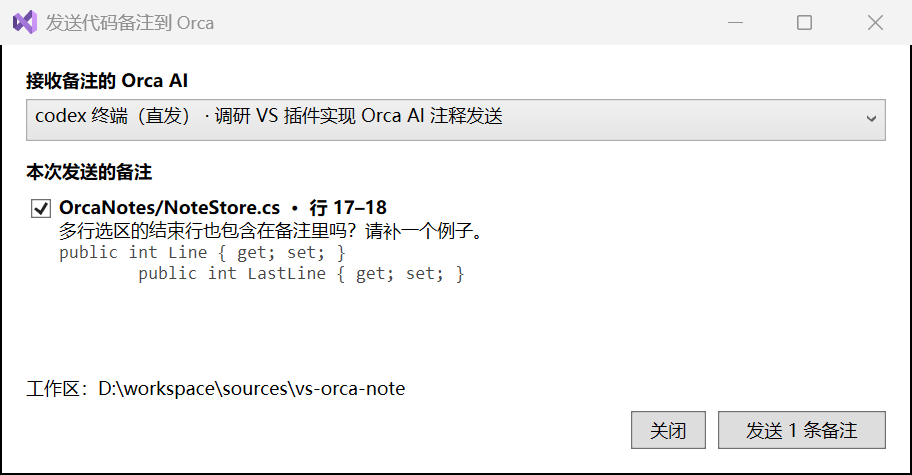

# Orca 代码备注

Windows Visual Studio 的 VSIX 扩展。在编辑器里给一行或一段代码加备注，选好 Orca AI 后，把当前工作区的多条备注一次发过去。



## 安装和使用

1. 从本仓库的 **Releases** 下载 `OrcaNotes-<版本>.vsix`，双击安装，勾选要安装或升级的 Visual Studio 实例，按提示重启。扩展上架后，也可以在 Visual Studio 的 **扩展 → 管理扩展** 中搜索 **Orca Code Notes**。此包面向 x64 Visual Studio 2022 17.14 和 2026。按钮、提示和发送窗口跟随 Visual Studio 的显示语言，支持简体中文和英文，其他语言默认显示英文。
2. 在 Orca 中打开项目，再用 Visual Studio 打开同一目录里的代码文件。把鼠标移到某行，点行号旁的 **＋**。要评论多行，先选中代码，再点选区内任一行的 **＋**。
3. 输入备注，点 **添加备注** 或按 **Ctrl+Enter** 保存。代码行下方会显示备注卡片。卡片右上角的纸飞机发送这一条，铅笔修改正文，垃圾桶删除备注。编辑时按 **Esc** 可取消修改。待发送备注保存在当前用户的 `%LOCALAPPDATA%\VsOrcaNotes\notes` 中，包含添加时的文件位置和代码快照。

   

4. 点 Visual Studio 顶部 **标准** 工具栏末尾的蓝色纸飞机 **发送工作区备注到 Orca**，可汇总当前工作区各个文件的备注。待发送条目默认勾选，可以取消勾选。选好接收会话后，点 **发送 N 条备注** 一次提交。收到提交回执后，对应的卡片和本地记录会自动删除。

   下图以单条备注为例。发送前可以核对接收会话、文件路径、行号和备注正文。

   

每条备注按以下格式发送。文件路径相对于 Orca 工作区，多行选区显示为 `Line: 66-68`，批量发送时各条备注之间空一行。

```text
File: src/Neuracle.Crane.UnitTests.Calculate/NcCalculateProcessorTests.cs
Line: 66
User comment: "测试"
```

选择 **终端（直发）** 时，备注会作为一条输入提交到选中的 Codex 或 Claude 等 AI 终端，可以在原对话中接着讨论。若同一工作区有多个候选，插件会尝试预选 Orca 报告的活动 AI 终端。请在发送前核对目标名称。Windows 单次命令行长度约为 3.2 万个字符，超过时可以分批发送。

选择 **Chat（收件箱）** 时，已有的原生 Chat 仍走 Orca 消息接口。仅此选项使用名为 **VS Orca Notes** 的发送终端。选择 **新建会话** 时，备注会作为新会话的第一条提示词。

若连接中断导致结果不确定，这批备注会标为待核对。下次打开发送窗口时，这些备注默认不勾选，可先查看 Orca 会话再决定是否重发。

## 从源码构建

用 Visual Studio 打开 [VsOrcaNotes.sln](VsOrcaNotes.sln)，选择 Release 并生成。也可以在 Visual Studio Developer PowerShell 中运行：

```powershell
msbuild VsOrcaNotes.sln -restore -p:Configuration=Release
```

生成的安装包在 `OrcaNotes\bin\Release\net472\OrcaNotes.vsix`。开发依赖通过 NuGet 还原。编辑器界面采用进程内 MEF 扩展和 WPF。Orca 通过本机的 `orca.exe` 调用，需能够从安装目录或 PATH 找到。

## 发布插件

### 首次配置

1. 将仓库推送到 GitHub，启用 GitHub Actions。
2. 在 Visual Studio Marketplace 创建或选择发布者，打开 **Trusted Publishing → Create**。填写策略名称、GitHub 仓库所有者和仓库名，**Workflow** 填 `release.yml`，**Environment** 留空。[发布者管理](https://marketplace.visualstudio.com/manage) · [微软配置指南](https://developer.microsoft.com/blog/trusted-publishing-visual-studio-marketplace/)
3. 点击 GitHub 仓库顶部的 **Settings**，在左侧 **Security** 区域展开 **Secrets and variables**，选择 **Actions**。在右侧页面切到 **Variables**，点击 **New repository variable**。**Name** 填 `VS_MARKETPLACE_PUBLISHER`，**Value** 填上述发布者的 **Publisher ID**，然后点击 **Add variable**。[GitHub 仓库变量设置指南](https://docs.github.com/en/actions/how-tos/write-workflows/choose-what-workflows-do/use-variables#creating-configuration-variables-for-a-repository)

发布时 GitHub Actions 通过 OIDC 获取短期凭据，无需保存个人访问令牌。[VSIX 可信发布说明](https://learn.microsoft.com/en-us/visualstudio/extensibility/walkthrough-publishing-a-visual-studio-extension-via-command-line#publish-from-github-actions-with-trusted-publishing)

私有仓库需在创建策略后 48 小时内推送首个发布标签，首次成功交换令牌后策略会永久激活。若已过期，可在 Marketplace 重新开启。[策略激活说明](https://developer.microsoft.com/blog/trusted-publishing-visual-studio-marketplace/#github-policy-lifecycle)

Marketplace 上的扩展标识为 `<Publisher ID>.OrcaCodeNotes`，公开展示名为 **Orca Code Notes**。商店介绍见 [Marketplace 说明](docs/marketplace.md)。

### 发布一个版本

将目标版本填入 [VSIX 清单](OrcaNotes/source.extension.vsixmanifest) 中的 `Identity.Version`，提交并推送。然后在同一提交上推送对应的版本标签。例如，清单版本为 `0.1.9` 时运行以下命令。

```powershell
git tag v0.1.9
git push origin v0.1.9
```

**Release VSIX** 工作流会构建并测试，核对标签、源码清单和 VSIX 内的版本，随后创建 GitHub Release，并将同一安装包提交到 Marketplace。若 GitHub Release 已成功而 Marketplace 发布失败，修复配置后在该次运行中选择 **Re-run failed jobs**，即可复用已构建的安装包。

只想试跑时，在 **Actions → Release VSIX → Run workflow** 选择分支即可构建、测试并下载安装包。手动运行仅生成名为 `vsix` 的 Actions artifact。
