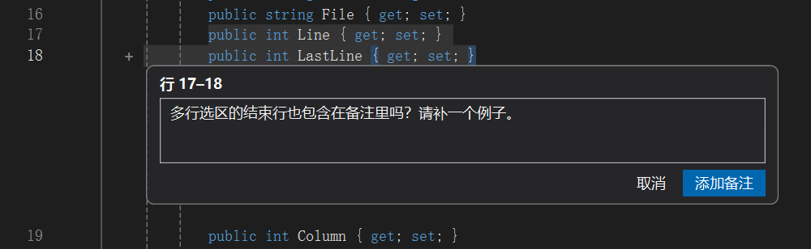
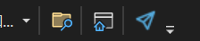
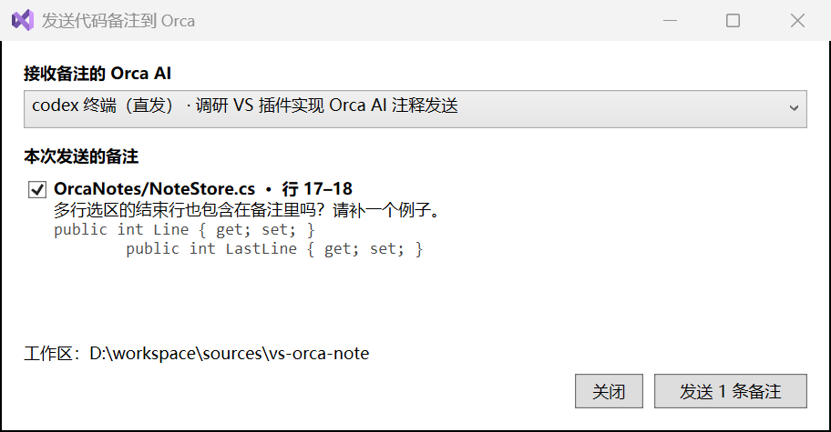

# Orca Code Notes

Add a review comment to a line or selection in Visual Studio and send it to an Orca AI conversation. Each comment includes the relative file path, line number or range, and your note.

## Add a note

Open the same project in Orca and Visual Studio. Hover over a line and click **+**. To comment on several lines, select them first. Write your comment, then press **Ctrl+Enter** to save it. You can edit or delete a saved comment from its card.

## Send notes to Orca

Click the paper plane on a note card to send one comment. To send several, click the blue paper plane on Visual Studio’s **Standard** toolbar.

Choose the Orca conversation, check the notes you want to send, then click **Send**. In this example, the note on lines 17–18 is ready to send to a Codex terminal.

Requires Orca and x64 Visual Studio 2022 (17.14) or Visual Studio 2026. The extension supports English and Simplified Chinese.
